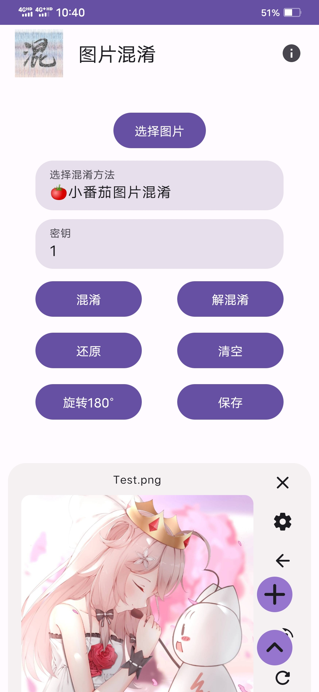
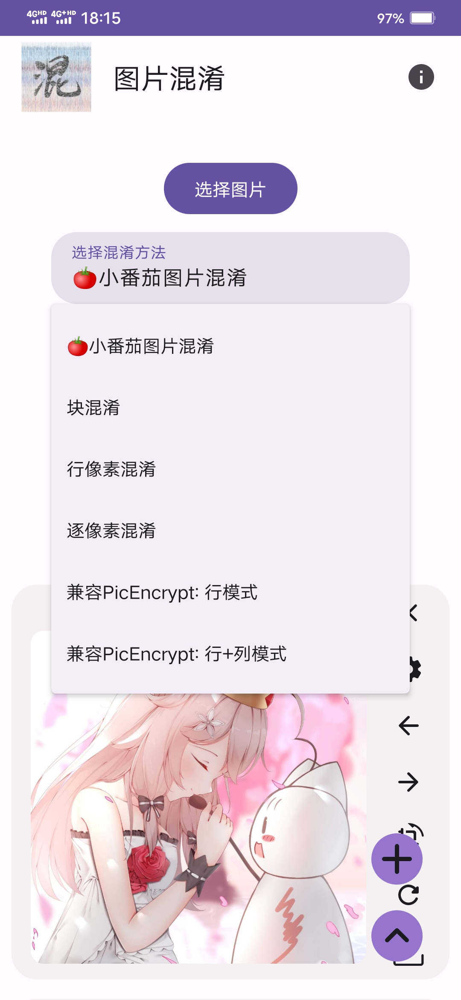

<h1 align="center">
  
  <br>
  RePix 图像工具箱
  <br>
</h1>

<h3 align="center">
现代、高性能、隐私优先的 Android 图像混淆、图种隐写与幻影坦克综合工具箱
</h3>

<p align="center">
  
  
  
  
  
  
</p>

---

## 📖 简介

**RePix** 是一款专为 Android 打造的高性能图像隐私保护与极客工具箱。无论是用于社交平台的图像防爬虫、防审核，还是安全的文件信息隐写，亦或是制作在不同背景下呈现双重视觉效果的“幻影坦克”，RePix 均能提供极致流畅的体验与比特级严苛的数学还原精度。

本项目基于现代 Android 架构彻底重塑，拥有纯 C++ 20 原生加速内核、零拷贝直接内存洗牌、现代 Jetpack Compose Material 3 界面与完整的 ViewModel 状态托管。

---

## ✨ 核心特性

### 1. ⚡ 强力图片混淆算法族 (Image Scramble)
* **经典 6 种混淆算法向前兼容**：小番茄置乱（Tomato Gilbert 曲线）、分块置乱（Block）、行像素打乱（Row）、全像素打乱（Per-Pixel）、PicEncrypt 兼容行打乱与行列混沌混淆。
* **全新 LCG 零拷贝极速洗牌**：采用对标 `java.util.Random` 的线性同余随机数发生器与 Fisher-Yates 原位洗牌，无需申请额外像素缓冲，毫秒级完成超大图片混淆与逆向解密。
* **C++ 20 高性能内核 + 双向安全兜底**：核心运算由 Native 层利用 OpenMP/多线程加速执行；提供**“Java 兼容兜底模式”**开关，保证在各类极端硬件环境下皆可稳健运行。

### 2. 📦 图种文件隐写与提取 (Steganography)
* **一键合成图种**：将 ZIP、RAR、7Z 等各类压缩包安全缝合至封面图片（JPG/PNG）末尾，生成可正常预览、传输的伪装图种。
* **智能特征码嗅探**：基于流式滑动窗口与分块识别，在无需将整个大文件加载至内存的前提下，秒级探测并解出内部隐藏的压缩包文件。

### 3. 🛡️ 幻影坦克 / 光棱坦克 (Mirage Tank)
* **经典黑白幻影坦克**：利用 Alpha 通道透明度合成，白色背景下显现表图，黑色背景（或点开大图）下显现里图。
* **光棱坦克 (全彩幻影)**：采用多通道动态色阶压缩与色彩还原补偿算法，实现令人惊叹的真彩色双重图像隐匿。
* **零拷贝合成输出**：全流程 C++ 底层直调，自动缩放规整尺寸，直接导出高保真无损 PNG。

---

## 📸 界面预览

| 图片混淆与解密 | 批量管理与工具分栏 |
| :---: | :---: |
|  |  |

---

## 🛠️ 系统兼容与技术栈

* **兼容环境**：Android 7.0 - Android 17 (API 24 - 37)
* **构建工具**：
  * Gradle: `9.8.1`
  * Android Gradle Plugin (AGP): `9.1.0`
  * JDK: `17`
  * C++ 标准: `C++20` (CMake 3.22.1)
  * Jetpack Compose: BOM `2026.09.00` / Material 3
* **架构设计**：Clean Architecture + Jetpack ViewModel 状态管理（屏幕旋转不丢失图片与状态）+ Kotlin 结构化协程并发。

---

## 🚀 从源码构建

1. **环境准备**：
   - 安装 JDK 17，并确保命令行环境变量 `JAVA_HOME` 指向 JDK 17。
   - 安装 Android SDK（包含 Build-Tools 37+、Platform 37、NDK 与 CMake）。

2. **克隆代码**：
   ```bash
   git clone https://github.com/vusiif/RePix.git
   cd RePix
   ```

3. **构建 Debug APK**：
   ```bash
   ./gradlew :app:assembleDebug
   ```
   产出文件位于 `app/build/outputs/apk/debug/app-debug.apk`。

4. **运行测试**：
   ```bash
   ./gradlew :app:testDebugUnitTest
   ```

---

## 💡 使用说明与算法密钥指南

### 算法与密钥范围

| 混淆算法 | 密钥类型 | 允许取值范围 | 说明 |
| :--- | :--- | :--- | :--- |
| **小番茄算法** | 浮点数 | `(0, 1.618]` | 默认推荐 `1`，基于吉尔伯特空间填充曲线 |
| **分块算法** | 字符串 | 任意字符 | 默认推荐 `0.666`，按网格分块置乱 |
| **行像素打乱** | 字符串 | 任意字符 | 默认推荐 `0.666`，水平行级位置置换 |
| **全像素打乱** | 字符串 | 任意字符 | 默认推荐 `0.666`，离散全图置乱 |
| **PicEncrypt 行打乱** | 浮点数 | `(0, 1.0)` | 默认推荐 `0.5`，Logistic 混沌映射 |
| **PicEncrypt 行列打乱** | 浮点数 | `(0, 1.0)` | 默认推荐 `0.5`，双向交织混沌置乱 |
| **⚡ 经典 LCG 洗牌** | 字符串 | 任意字符 | 零拷贝极速原位 Fisher-Yates 洗牌 |

> **⚠️ 注意**：解混淆必须使用与混淆时**完全相同的算法和密钥**。

### 无法还原原图的常见原因

1. **图片在传输中被二次压缩**：
   - 微信、QQ 或贴吧等平台如果未勾选“发送原图”，图片会被有损压缩为 JPEG，丢失精准像素值，导致混淆无法还原。
2. **操作顺序与次数未严格对称**：
   - 若对原图连续进行了 2 次混淆操作，解混淆时必须以**完全相反的顺序**执行 2 次解混淆。
3. **算法或密钥不匹配**：
   - 请向混淆图片的发布者确认当时所使用的具体算法与密码。

---

## 📄 开源许可

本项目遵循 [Apache-2.0 License](LICENSE)。核心混淆数学原理及相关参考实现致敬开源社区与逆向工程探索者。
